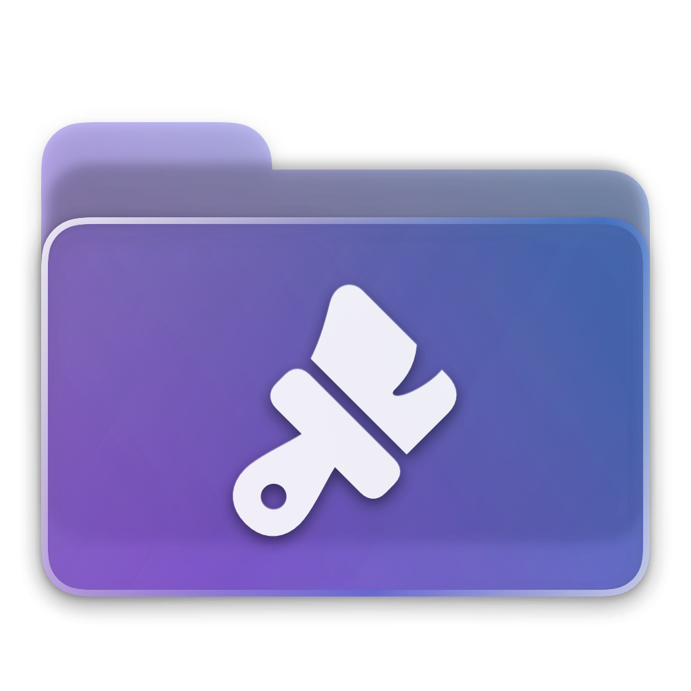
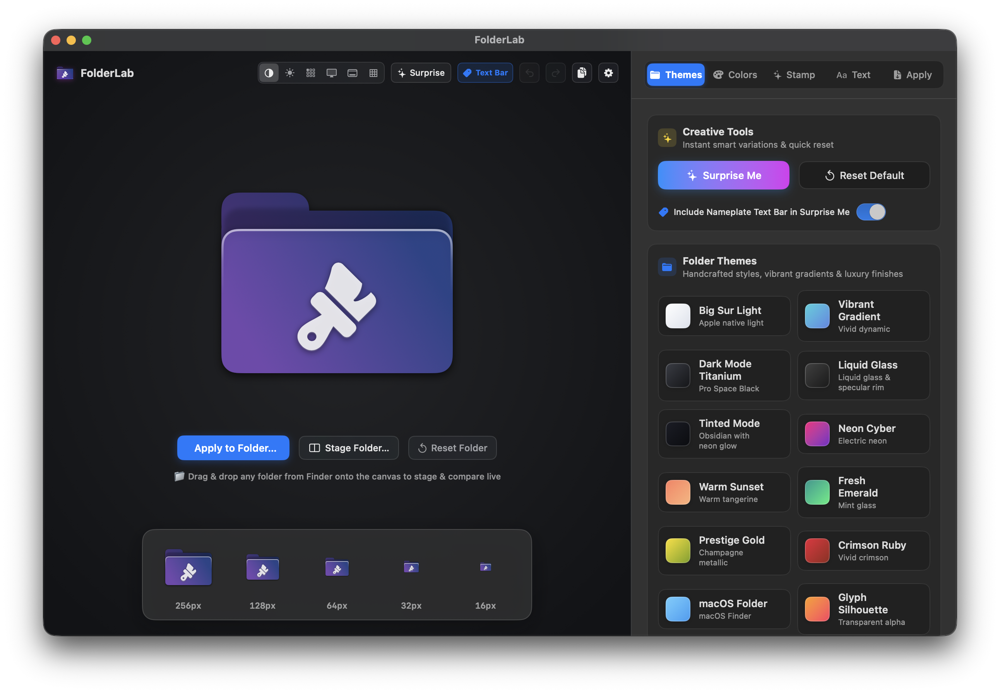

<p align="center">
  
</p>

<h1 align="center">📁 FolderLab 🧪✨</h1>

<p align="center">
  <b>The modern, native macOS studio to customize, stamp, and skin Finder folders in real time! 🎨🚀</b><br>
  <i>Crafted with SwiftUI & AppKit • Apple Liquid Glass • SF Symbols • Open Source 🌟</i>
</p>

<p align="center">
  
  
  
  
  
</p>

<p align="center">
  
</p>

---

## 🌟 Highlights & Features

- 🏷️ **Folder Nameplate / Label Banner on Icon (v0.4)**: Customizable horizontal text banner or embossed label across the folder flap! Choose from 7 distinct styles: **Retro Dymo Embossed Tape**, **Modern Glass Capsule**, **Engraved Brass Plaque**, **Cyber Neon Ribbon**, **Paper Masking Tape**, **Minimal Clean Tag**, and **Text Only**, with authentic native macOS folder debossed/engraved styling, customizable vertical position, scale, text, and colors! 🏷️✨
- 🔤 **Unicode Folder Renamer Studio (v0.4)**: Pick from 14 expressive Unicode typography styles (*Bold Sans, Bold Serif, Script / Calligraphy, Monospace, Double-Struck Blackboard, Fraktur Gothic, Circled / Dark Bubbles, Small Caps, Fullwidth*), preview live in real-time, and rename folders on your Mac directly on disk via Finder! 📁🖋️
- 🪨 **Visual Texture Swatch Grid (v0.3)**: Interactive card preview gallery displaying tactile surface finishes (Carbon Fiber, Brushed Metal, Tactile Pebble Grain, Dot Matrix Grid, Diagonal Ribs) rendered live over active folder colors! 🎨
- 🪄 **Surprise Me (v0.4 Enhanced)**: Prominently placed at the top of Themes, generating procedural textures, 24 curated tri-color palettes, 3-stop mesh gradients, corner badges, monograms, liquid glass, and procedural nameplates across 6 intelligent aesthetic archetypes with 1 click! ✨
- 📦 **Unified Apply & Export Hub (v0.3)**: Centralized all export functions (Live Finder Folder Skinning, Batch Styler, Clipboard PNG, ICNS package, and .folderlab preset export/import) into the Apply tab! 🚀
- 🪄 **Smart Folder Auto-Suggestions**: Intelligent directory detection (Code, Documents, Photos, Music, Finance, Archive, etc.) with instant 1-tap style recommendations! 📁
- 🧶 **Procedural Surface Textures (v0.2)**: Vector-sharp Carbon Fiber, Brushed Metal, Tactile Leather Grain, Dot Matrix Grid, and Diagonal Ribs! 🪨
- 🎨 **3-Stop Multi-Color Gradients (v0.2)**: Rich multi-stop gradients with middle accent color transitions for modern mesh aesthetics! ✨
- 🏷️ **Corner Status Mini-Badges (v0.2)**: Engrave discrete corner badges (Lock 🔒, Star ⭐, Checkmark ✅, Warning ⚠️, Cloud ☁️, Tag 🏷️) with custom tinting!
- ✍️ **Typography & 3D Depth Stamping (v0.2)**: SF Pro Rounded, SF Mono, and New York Serif fonts with Embossed or Engraved 3D tactile bevels! 🔮
- ↩️ **Full Undo & Redo (v0.2)**: 30-level state history with `⌘Z` / `⇧⌘Z` keyboard shortcuts and canvas toolbar buttons! ⚡
- 🕒 **Recently Applied Styles Shelf (v0.2)**: Horizontal recents gallery in the Themes inspector to quickly re-apply your favorite folder designs! 🎨
- ⚡ **Automatic 1-Click In-App Updater (v0.4)**: Seamless silent background installation! Clicking "Update Now" automatically mounts the installer, upgrades FolderLab, strips quarantine flags, and relaunches with zero manual dragging! 🚀
- 🎯 **Direct Finder Drag & Drop**: Simply drag any folder from macOS Finder directly onto the preview stage to customize it instantly! ⚡
- 🗂️ **Batch & Bulk Folder Styler**: Select multiple directories at once or re-theme all subfolders in a folder with one tap! 📁
- 🖼️ **Custom Image & Stamp Importer**: Drop any PNG, JPG, or SVG image to stamp logos, team badges, or stickers onto the folder flap! 🎨
- 🏷️ **Native Finder Tag Color Sync**: Live integration with Apple Finder tag colors (Red 🔴, Orange 🟠, Yellow 🟡, Green 🟢, Blue 🔵, Purple 🟣, Gray ⚪).
- 🧊 **Apple Liquid Glass Aesthetics**: Dynamic glass translucency, frosted diffusion sheen, and specular rim chamfers! 💎
- ✨ **SF Symbol Stamping**: Laser-engrave over 140+ curated Apple SF Symbols with custom tint gradients, shadows, and scaling! 🔮
- 🖥️ **Live Multi-Scale Previews**: Check how your design looks across Finder sizes — Dock (68px), Large Icon (128px), List (64px), and Sidebar (16px)! 🔍
- 💾 **Portable Preset Packs (`.folderlab`)**: Export and share your handcrafted folder themes with friends and teammates! 🤝
- 📦 **Lossless High-Res Export**: Save your custom icons as production-ready Apple `.icns` packages or 1024×1024 master PNGs! 🚀

---

## 🎨 Pre-Built Themes & Aesthetic Finishes

| Theme | Gradient Swatch | Aesthetic Vibe |
| :--- | :--- | :--- |
| 🌊 **Classic Blue** | `#6CD0FF` → `#2F9DF4` | Authentic macOS Finder native look 🍏 |
| 🌘 **Dark Graphite** | `#3A3D45` → `#181A1F` | Sleek Space Black & Pro studio dark mode 🖤 |
| ⚙️ **Titanium Slate** | `#5E6573` → `#3A3F49` | Industrial brushed metal & minimal slate 🪨 |
| 🧊 **Liquid Glass** | `Translucent Glass` | Smoked crystal glass with specular edge rim 💎 |
| 🔮 **Neon Cyber** | `#FF007F` → `#7928CA` | Electric synthwave glow & vivid magenta ⚡ |
| 🌅 **Warm Sunset** | `#FF7E5F` → `#FEB47B` | Golden hour glow & warm tangerine horizon 🌇 |
| 🌿 **Mint Emerald** | `#11998E` → `#38EF7D` | Vibrant organic foliage & emerald glass 🌱 |
| 🍷 **Crimson Ruby** | `#ED213A` → `#93291E` | Deep executive scarlet & velvet ruby finish 🌹 |
| 👑 **Champagne Gold** | `#F6D365` → `#FDA085` | Luxury metallic shimmer & warm champagne ✨ |

---

## 🛠️ How It Works in 3 Easy Steps

1. 🎨 **Craft your design**: Pick a vibrant color palette, adjust glass translucency, or choose an SF Symbol / custom stamp image.
2. 🗂️ **Drop your folder**: Drag any folder from Finder directly into FolderLab, or click **"Apply to Folder…"**
3. 🎉 **Done!**: Your folder in Finder is updated immediately with your bespoke icon! 🚀

---

## 🚀 Getting Started

### ⚡ 1-Line Install (Zero Popups — 100% Free)
The easiest way to install without macOS Gatekeeper warning popups:
```bash
curl -fsSL https://raw.githubusercontent.com/balshaansingh29/FolderLab/main/install.sh | bash
```
*This downloads the latest build, moves it into `/Applications`, clears the quarantine flag, and launches FolderLab immediately.*

---

### 🍺 Homebrew Install
If you use Homebrew:
```bash
brew install --cask https://raw.githubusercontent.com/balshaansingh29/FolderLab/main/Casks/folderlab.rb
```
*Homebrew automatically manages quarantine removal during installation.*

---

### 📥 Manual Download (DMG / ZIP)
Grab the latest pre-compiled build:
- 💿 **[FolderLab-v0.4.dmg](https://github.com/balshaansingh29/FolderLab/releases/download/v0.4/FolderLab-v0.4.dmg)** *(Clean drag-and-drop installer for `/Applications`)*
- 📦 **[FolderLab-v0.4.zip](https://github.com/balshaansingh29/FolderLab/releases/download/v0.4/FolderLab-v0.4.zip)** *(Standalone application archive)*

> [!TIP]
> **First time opening on macOS?**
> Because FolderLab is a free community open-source app (not distributed via the \$99/yr Apple Developer Program), macOS Gatekeeper may show *"Apple could not verify FolderLab.app"*.
> - **Option 1**: **Right-click** (or Control-click) `FolderLab.app` in Finder → select **Open** → click **Open**.
> - **Option 2**: Go to **System Settings → Privacy & Security** → scroll down and click **Open Anyway**.
> - **Option 3**: In Terminal: `xattr -cr /Applications/FolderLab.app`

---

### 📋 Prerequisites (For Developers)
- 🍏 **macOS 13.0 (Ventura)**, **macOS 14 (Sonoma)**, or **macOS 15 (Sequoia)**
- 🛠️ **Xcode 15+** or **Swift 5.9+** toolchain

### ⚡ Running from Terminal
```bash
# 1. Clone the repository 📦
git clone https://github.com/balshaansingh29/FolderLab.git

# 2. Enter the project directory 📁
cd FolderLab

# 3. Build & launch instantly! 🚀
swift run
```

Or simply open `Package.swift` in Xcode and press **⌘R** to run! ▶️

---

## 🛡️ Security & Privacy: Is FolderLab Safe?

When opening FolderLab for the first time, macOS may show a prompt saying **"Apple could not verify FolderLab.app is free of malware"**. Here is why this happens and why FolderLab is completely safe to run.

### ❓ Why Does This Popup Appear?
1. **Apple Developer Program Fee (\$99/year)**: Apple requires developers to pay an annual subscription to notarize Mac apps. Because **FolderLab is 100% free, independent, and open-source**, we do not charge users or pay Apple's commercial developer fee.
2. **Default Gatekeeper Warning**: macOS displays this generic automated warning for *any* application downloaded from the internet without an Apple Developer ID. It does **not** mean the app contains malware, viruses, or security risks.

### 🔒 4 Reasons Why FolderLab is 100% Safe:
- 📖 **100% Open Source & Auditable**: Every single line of Swift code is public and transparently viewable right here in this GitHub repository.
- 🚫 **Zero Tracking & No Analytics**: FolderLab operates entirely offline on your Mac. No telemetry, no background network beacons, no tracking, and no ads.
- 🍏 **Native Apple AppKit & SwiftUI APIs**: Folder icon changes are applied locally using Apple's official `NSWorkspace.shared.setIcon` system framework. No background daemons, system extensions, or kernel modifications.
- 🛠️ **Build It Yourself Anytime**: If you have Xcode or the Swift toolchain installed, you can inspect the code and compile the entire project directly with `swift run`.

### 🚀 How to Open FolderLab (Takes 2 Seconds):
- **Option 1 (Right-Click)**: Right-click `FolderLab.app` in `/Applications` → click **Open** → click **Open**. macOS will remember your permission permanently.
- **Option 2 (System Settings)**: Go to **System Settings  → Privacy & Security** → scroll down and click **Open Anyway**.
- **Option 3 (1-Line Terminal Quick-Install — Zero Popups)**:
  ```bash
  curl -fsSL https://raw.githubusercontent.com/balshaansingh29/FolderLab/main/install.sh | bash
  ```

---

## 📄 License

Distributed under the **MIT License**. See [`LICENSE`](LICENSE) for details. Enjoy skinning your folders! 📁✨
